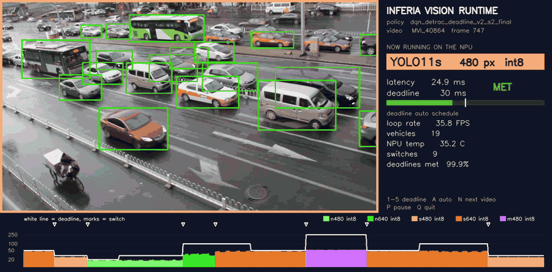
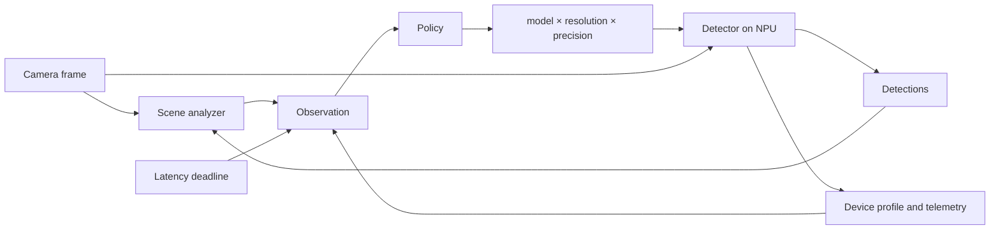

# Inferia Vision Runtime

**Adaptive object detection for edge devices.** Inferia Vision Runtime (IVR) is a scheduling layer that sits between the camera and the detector and decides, for every frame, which model, input resolution and numerical precision to run, so the device always delivers the most accurate detections that still fit the current latency budget.



*Recorded on a Radxa ROCK 5C (RK3588S2 NPU). The latency deadline (white line in the timeline) changes every few seconds; the policy steps between YOLO11 nano, small and medium at different resolutions to follow it. Each colour is one configuration, each ▼ marks a switch. Over the full 1,515 frame sequence this run met 99.9% of its deadlines with 19 switches, at a median of 29 frames per second for the whole loop.*

## Why IVR

Edge vision deployments usually fix one detector configuration at install time. That configuration is a compromise that is wrong most of the time:

- **Size it for the tightest budget** and you throw away accuracy whenever the device has time to spare.
- **Size it for accuracy** and it falls behind whenever the budget tightens: the camera frame rate goes up, another workload takes the NPU, or a downstream controller needs answers faster.

IVR replaces that fixed choice with a policy that reads the current deadline and a few cheap scene and hardware signals every frame and picks one of eighteen detector configurations. On the UA-DETRAC traffic benchmark under a changing deadline it is more accurate than the fastest configuration and late far less often than any more accurate one:

| Scheduler | Detection F1 | Frames late |
|---|---|---|
| **IVR, DQN policy** | **0.80 to 0.82** | **0%** |
| **IVR, deadline masked PPO policy** | **0.80 to 0.82** | **0%** |
| Always YOLO11n, 480 px, int8 (fastest) | 0.768 | 0% |
| Always YOLO11s, 480 px, int8 | 0.830 | 22% |
| Always YOLO11s, 640 px, int8 | 0.851 | 40% |
| Always YOLO11m, 960 px, int8 (most accurate) | 0.863 | 77% |

*40 held out UA-DETRAC test sequences, deadlines drawn from 20, 30, 50, 100 and 250 ms and held for 2 to 6 seconds, latency measured on the ROCK 5C. Three training seeds per policy. Full methodology and every baseline in [docs/experiments.md](docs/experiments.md).*

On the device itself, over four complete held out sequences (crowded, rainy, night, sparse), the DQN policy met 97.0 to 99.9% of its deadlines measured end to end on the NPU, switching between nano, small and medium 11 to 19 times per sequence.

## Features

- **Per frame configuration switching.** 3 models (YOLO11 n/s/m) × 3 resolutions (480/640/960) × 2 precisions, 18 configurations, all preloaded so a switch never stalls on a model load.
- **Deadline aware.** The deadline is an input, not a constant: set it from the application every frame, or let a schedule drive it.
- **Hardware profile driven.** Policies are trained against a measured latency profile of the target device, so what the scheduler believes fits is what actually fits on the board.
- **Rockchip RK3588 NPU deployment.** RKNN conversion in fp16 and calibrated int8, with a split detection head that keeps int8 accuracy within 0.03 F1 of the GPU reference.
- **Learned, not hand tuned.** DQN, PPO and MaskablePPO training from ground truth matched detection accuracy, with a switching cost so the policy does not flicker.
- **Acceptance harness.** Benchmarks any policy against all 18 fixed configurations, a profiled lookup table, a contextual bandit, a rule based and a random scheduler, with paired statistics per sequence.
- **Live operator view.** A full screen viewer for the device desktop (works over VNC) showing detections, the running configuration, latency against deadline and a scrolling timeline.

## How it works



Every frame the scene analyzer computes cheap features without running the detector: motion, the previous object count, mean confidence and box size, brightness, entropy and temporal box overlap. Together with telemetry (loop rate, last latency, last action), the device profile of the running configuration (NPU load, memory, temperature, power) and the current deadline, they form a 19 value observation. The policy maps it to a configuration for the next frame, and the detector runs it.

During training the same loop runs on recorded footage with ground truth. The reward is the frame's detection F1 against the labels (IoU 0.5, UA-DETRAC's vehicle classes and ignore regions), minus a fixed penalty for every frame whose measured latency exceeds its deadline and a small cost for each switch. Nothing tells the policy which configuration is fast or accurate; it learns that from reward.

## Supported hardware

| Device | Status |
|---|---|
| Radxa ROCK 5C (Rockchip RK3588S2, 8 GB) | Deployed and measured: all 18 configurations converted, profiled and run live |
| Other RK3588 / RK3588S boards | Expected to work with the same RKNN models; re-measure the profile |
| Other accelerators | Train against `configs/hardware.yaml` with your own measured latencies; the detector backend on the device needs porting |

Measured end to end latency on the ROCK 5C (letterbox, NPU, decode and NMS, clocks pinned) for the configurations the deadline levels are built around:

| Configuration | Latency |
|---|---|
| YOLO11n 480 int8 | 16.7 ms |
| YOLO11s 480 int8 | 24.4 ms |
| YOLO11s 640 int8 | 42.8 ms |
| YOLO11s 960 int8 | 94.1 ms |
| YOLO11m 960 int8 | 199.6 ms |

## Installation

**Host** (training and evaluation, Python 3.9+, a CUDA GPU recommended):

```bash
git clone <this repository> && cd Inferia-Vision-Runtime
python -m venv .venv && source .venv/bin/activate   # .venv\Scripts\activate on Windows
pip install -e .
```

YOLO11 weights (`yolo11n.pt`, `yolo11s.pt`, `yolo11m.pt`) go in `weights/`. Training data is UA-DETRAC, with images and XML annotations under the `dataset_dir` set in `configs/env/env_detrac*.yaml`.

**Device** (Radxa ROCK 5C running Debian 12): a Python virtual environment with `rknn-toolkit-lite2` (2.3), `rknn-toolkit2` (for on-device conversion), `numpy`, `opencv-python`, `pyyaml`, `torch` (CPU) and `stable-baselines3`, plus a copy of this repository.

## Quick start

### 1. Train a policy

```bash
python train.py --env configs/env/env_detrac_deadline.yaml \
    --reward configs/reward/reward_detrac_deadline.yaml \
    --training configs/training/training_dqn_deadline.yaml \
    --hardware configs/hardware_measured.yaml \
    --algorithm dqn --seed 0 --log-name dqn_detrac_deadline_s0
```

Checkpoints are written to `training/`. For the deadline masked PPO policy use `--training configs/training/training_ppo_deadline_short_horizon.yaml --algorithm maskable_ppo`.

### 2. Accept it against the baselines

```bash
python tooling_scripts/detrac_full_eval_parallel.py \
    --env configs/env/env_detrac_deadline.yaml \
    --reward configs/reward/reward_detrac_deadline.yaml \
    --hardware configs/hardware_measured.yaml \
    --fixed all --baselines --deadline-lookup output/deadline_lookup_accuracy.yaml \
    --model ivr_dqn_s0=training/dqn_detrac_deadline_s0_final.zip \
    --output test_detrac_deadline_eval.csv --stats-reference ivr_dqn_s0
```

This runs the policy, all 18 fixed configurations and the non learning schedulers over every test sequence and writes per sequence reward, F1 and deadline misses, plus paired statistics. `--deadline-lookup` is optional and adds the profiled lookup table baseline; it takes a YAML of each model and resolution's F1 on the training split.

### 3. Deploy to the board

```bash
# host: export fixed shape ONNX models plus calibration and evaluation frames
python tooling_scripts/rknn_export_onnx.py --out ../rknn_bundle

# board: convert to RKNN (fp16 and int8), then measure every configuration
python rknn_convert.py --bundle ~/ivr/bundle
sudo ~/ivr/venv/bin/python rknn_benchmark.py --bundle ~/ivr/bundle --mode latency --cores 3
python rknn_benchmark.py --bundle ~/ivr/bundle --mode detect

# host: turn the measurements into the profile policies are trained against
python tooling_scripts/rknn_measured_profile.py --bundle ../rknn_bundle
```

`rknn_measured_profile.py` writes `configs/hardware_measured.yaml`. Retrain against it (step 1) whenever the device, firmware or models change.

### 4. Run it live

Pin the CPU, NPU and memory clocks first (a reboot resets them), then start the runtime with the viewer:

```bash
python rknn_live_demo.py --repo ~/ivr/repo --bundle ~/ivr/bundle \
    --policy ~/ivr/policies/dqn_detrac_deadline_s0_final.zip \
    --sequence MVI_40864 MVI_40742 --show --fullscreen --loop --hold-frames 40 90
```

Without `--show` it runs headless and writes the annotated stream to `<bundle>/demo_out/<policy>_<sequence>.mp4` with a per frame CSV trace (configuration, latency, deadline, met or missed, NPU temperature, switch). The summary printed at exit reports deadlines met, switches, loop rate and configuration usage.

| Key | Action |
|---|---|
| `1` to `5` | Set the deadline to 20, 30, 50, 100 or 250 ms |
| `A` | Return to the automatic deadline schedule |
| `N` | Next video |
| `P` | Pause |
| `Q` | Quit |

In the viewer, hue identifies the model (nano green, small orange, medium purple), shade the resolution and a hue shift the precision; the frame border and the status box take the colour of the configuration running on the NPU.

## Configuration

| File | Controls |
|---|---|
| `configs/variants.yaml` | Model pool, resolutions and precisions that make up the action space |
| `configs/hardware.yaml` | Device profile: physical limits, simulated estimates and policy budgets |
| `configs/hardware_measured.yaml` | The same profile with latency, NPU load and temperature measured on the device |
| `configs/env/env_detrac_deadline.yaml` | Dataset, episode length, deadline levels (`deadline_levels_ms`) and hold time (`deadline_hold_frames`) |
| `configs/reward/reward_detrac_deadline.yaml` | Accuracy scoring, deadline miss penalty, switching cost |
| `configs/training/*.yaml` | DQN and PPO hyperparameters |

### Adapting IVR to your deployment

- **Different deadlines.** Edit `deadline_levels_ms`; place each level just above the measured latency of a configuration you want it to unlock, then retrain.
- **Different device.** Measure each configuration's latency (step 3), write it into the `measured:` section of a copy of `configs/hardware.yaml` and train with `--hardware` pointing at it.
- **Different models.** Add them to `configs/variants.yaml`; the action space grows to models × resolutions × precisions.
- **Different scenes.** Any footage with per frame box annotations can train a policy; the UA-DETRAC source in `vision_pipeline/detrac_source.py` is the reference implementation of a frame source with ground truth.

## Validation

```bash
python tooling_scripts/validate_pipeline.py
```

The offline validation suite checks constraint behaviour, switching penalties, checkpoint round trips, observation wiring, deadline flags and masking, and that profile latency reaches the reward. Run it after any change to the environment, reward or hardware profile and before starting a long training run.

## Project layout

```
configs/               action space, device profiles, environment, reward and training configs
vision_pipeline/       YOLO detector wrapper, scene analyzer, video and UA-DETRAC frame sources
reinforcement_learning/  the training environment, reward, observation builder and trainer
runtime/               environment factory, device profile, latency model, telemetry
evaluation/            baseline schedulers and the benchmark runner
model_management/      model registry and the flattened 18 configuration space
tooling_scripts/       evaluation, RKNN export / convert / benchmark / profile, live runtime, validation
docs/                  experiment record, design notes and figures
train.py, eval.py, sweep.py   command line entrypoints
```

## Known limitations

- Late frames concentrate at the 20 ms deadline: nano at 480 px has a 17.5 ms median on the ROCK 5C, leaving little margin, and there is no faster configuration to fall back to.
- Under a fixed latency budget on fixed traffic cameras the policy matches, but does not beat, the best single configuration. The gain comes from budgets that change.
- A lookup table hand built from the device profile and an offline accuracy table is within 1 to 3% of the learned policies on UA-DETRAC; the policies reach that behaviour from reward alone and also take scene and hardware state into account.
- Power draw is simulated; the ROCK 5C has no power sensor.
- Validated on vehicle detection from fixed traffic cameras. Other domains need their own training footage.

## Further reading

- [docs/experiments.md](docs/experiments.md): full experiment record, from the first proxy reward to the deadline experiment and on device runs
- [docs/architecture.md](docs/architecture.md): architecture, components and design decisions
- [docs/proof_of_concept.md](docs/proof_of_concept.md): the first single-video model switching result
- [docs/RUN_BDD.md](docs/RUN_BDD.md): training and evaluating on BDD-A dashcam footage
