# Inferia Vision Runtime

Inferia Vision Runtime (IVR) is an experiment in treating object detection not as a single fixed pipeline but as a sequence of decisions. Most vision systems pick one model, one input resolution and one numerical precision at deployment time and then run that exact configuration on every single frame for the lifetime of the system, whether the scene in front of the camera is an empty parking lot or a packed intersection. That choice is almost always wasteful in one direction or the other. A model sized for the worst case burns compute and battery on easy frames, and a model sized for the easy case falls apart the moment the scene gets crowded. IVR trains a reinforcement learning agent to make that choice itself, frame by frame, based on what it currently sees and what the underlying hardware can currently afford.

The agent sits between the camera and the detector. Every frame it looks at a small set of cheap signals (how much motion is in the scene, how many objects were seen a moment ago, how bright the image is, how loaded the hardware currently is) and picks one of eighteen possible runtime configurations: a model size, an input resolution and a numerical precision. That configuration is then used to run the actual detector on the frame, and the resulting detection quality, latency and resource cost are folded into a reward signal that trains the agent to make better choices over time. The goal is not to build a better detector. YOLO11 already exists and works fine. The goal is to build the layer that decides, moment to moment, which version of YOLO11 is worth running right now.

## Why this is a real problem and not a toy one

Anyone deploying vision models on constrained hardware, a Raspberry Pi class board, a drone, a body camera, a warehouse robot, runs into the same wall almost immediately. The device does not have the headroom to always run the most accurate model, but it also cannot afford to always run the cheapest one, because a scene can go from empty to crowded within a couple of seconds and a system that is not watching for that will simply miss things. Engineers usually solve this with hand written heuristics: if the object count crosses some threshold, switch to a bigger model, if the battery drops below some percentage, switch to a smaller one. Those heuristics work until the environment changes slightly and the fixed thresholds stop making sense. IVR replaces the heuristic with a learned policy that discovers the trade off on its own, from reward, rather than from a rule someone wrote down in advance.

This repository is the implementation of that idea end to end: the environment the agent trains in, the reward functions it optimizes, the hardware model it is constrained by, and the evaluation harness that checks whether any of this actually produced something better than just picking one fixed configuration and leaving it alone.

## Architecture

The system is organized as a loop. A frame source hands a frame to a scene analyzer, which extracts cheap features without running the detector. Those features, combined with the hardware's current state, become the observation the agent sees. The agent picks an action, which is decoded into a concrete model, resolution and precision. That configuration is used to actually run the detector on the frame. The detector's output, together with the true cost of running that configuration, is turned into a reward. The agent updates on that reward and the loop continues on the next frame.

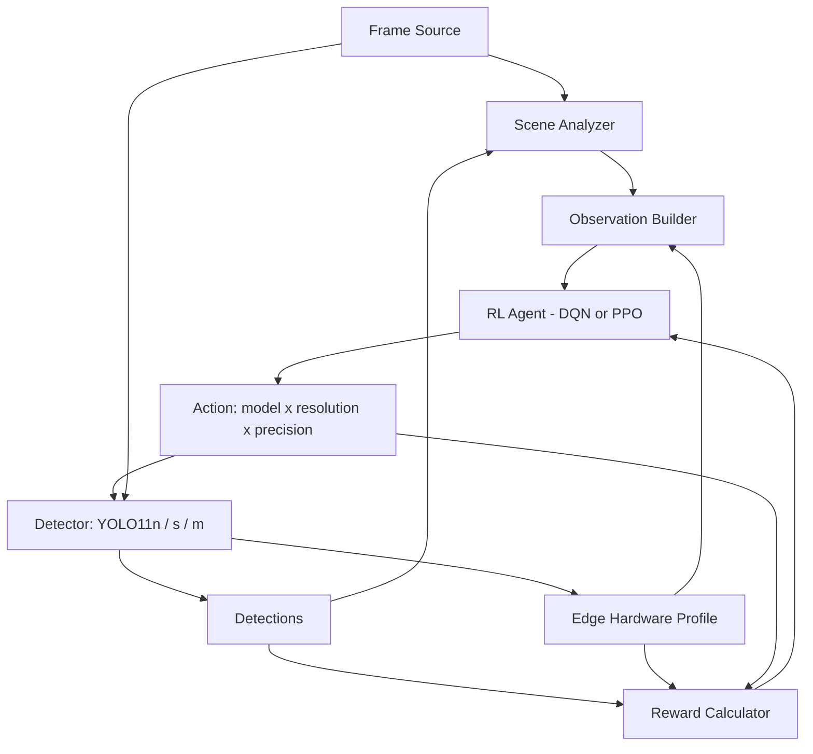

The hardware profile is worth calling out on its own, because it is the piece that makes the whole exercise meaningful rather than academic. Training happens on a desktop GPU with far more memory and power headroom than any real edge device, so if the agent were allowed to observe and be rewarded against the training GPU's actual behaviour, it would simply learn that every configuration is free and default to the most expensive one every time. This is exactly what happened in early versions of this project. Instead, IVR models the resource profile of a Rockchip RK3588S2 board (the target deployment hardware), giving latency, shared memory use, NPU utilisation, power draw and temperature for each of the eighteen possible configurations, and it is this profile, not the real training GPU, that the agent observes and is rewarded and constrained by. The separation between physical specification, simulated parameters, policy budget and measured values is kept explicit in the code, which is what made swapping in numbers measured on the real board a configuration change rather than a rewrite.

## The state and action spaces

The agent's observation is a fourteen dimensional vector, normalised to the zero to one range, updated every frame before the detector even runs on that frame. The first ten dimensions come from the scene analyzer and are cheap by design: motion magnitude between consecutive frames, the object count from the previous frame, mean detection confidence, mean bounding box area, image brightness, image entropy, a temporal consistency score computed from box overlap across frames, current measured frames per second, the latency of the last inference call and the index of the action taken last time. The remaining four dimensions come from the simulated hardware profile for whatever configuration is currently active: NPU utilisation, memory used against the inference budget, temperature and power draw. The idea is that the agent should be able to answer two separate questions from its observation alone, how complex is the scene right now, and how much room does the hardware currently have to spend. In the time varying deadline experiment described further down, five more dimensions are appended, one flag per deadline level that is set when the current latency deadline is at least that level, giving nineteen dimensions.

| Dimension | Signal | Source |
|---|---|---|
| 0 | Motion magnitude | Scene analyzer |
| 1 | Object count (normalised) | Scene analyzer |
| 2 | Mean detection confidence | Scene analyzer |
| 3 | Mean bounding box area | Scene analyzer |
| 4 | Brightness | Scene analyzer |
| 5 | Image entropy | Scene analyzer |
| 6 | Temporal consistency (IoU across frames) | Scene analyzer |
| 7 | Current FPS | Telemetry |
| 8 | Last inference latency | Telemetry |
| 9 | Last action taken | Agent history |
| 10 | Simulated NPU utilisation | Edge hardware profile |
| 11 | Simulated memory pressure | Edge hardware profile |
| 12 | Simulated temperature | Edge hardware profile |
| 13 | Simulated power draw | Edge hardware profile |

The action space is the Cartesian product of three model sizes (YOLO11 nano, small and medium), three input resolutions (480, 640 and 960 pixels) and two numerical precisions (fp32 and fp16), giving eighteen discrete actions in total. This is deliberately a flat discrete space rather than three separate continuous or hierarchical choices, mostly because it keeps the problem approachable for off the shelf algorithms like DQN and PPO without needing custom multi head architectures, at the cost of the action space growing multiplicatively if more dimensions were added later.

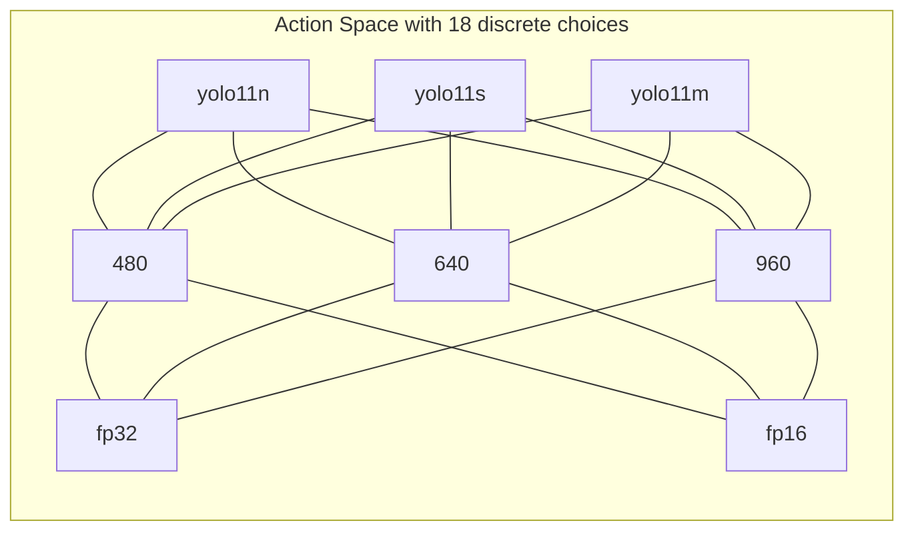

## Reward, and the difference between guessing quality and measuring it

The reward computed on every step balances four competing terms: detection quality, inference latency, compute cost and a penalty for switching configuration too often, on top of a hard penalty if the chosen configuration would exceed the simulated hardware's power, memory, temperature or latency budget.

```
reward = w_quality * (0.7 * quality + 0.3 * stability)
       - w_latency * min(1, latency / max_latency)
       - w_compute * compute_cost(action)
       - w_switch * (1 if action changed else 0)
       - constraint_penalty
```

The switching penalty exists because a policy that flickers between a cheap and an expensive model every other frame is not actually useful even if it scores well on paper, real deployments pay a real cost for reconfiguring a model, loading different weights and re-warming caches, so the reward has to reflect that. The constraint penalty is proportional to how far a configuration would exceed the simulated hardware's budget, not a hard mask on which actions are legal, which keeps the underlying DQN and PPO implementations completely unmodified.

The quality term is the part of this project that changed the most, and it is worth explaining honestly why. The first dataset used for training was BDD-A, a large set of real dashcam driving footage. BDD-A is genuinely useful footage but it was collected for a driver attention study, which means it comes with gaze heatmaps rather than object detection labels. There is no ground truth to compare a detector's output against. Early training used a proxy for quality instead, mean detection confidence multiplied by object count relative to a target count, on the reasoning that a detector which is confident and finds a reasonable number of objects is probably doing well. That proxy is a guess, not a measurement, and it eventually became the ceiling on what the whole system could learn, because a policy can only be as good as the signal it is trained against.

UA-DETRAC is a different kind of dataset: one hundred sequences of real traffic camera footage with every vehicle in every frame hand annotated with a bounding box. Once ground truth boxes exist, quality can be computed properly rather than guessed at. IVR's real reward backend matches each predicted box against the closest ground truth box by intersection over union at a threshold of 0.5, and from that greedy matching computes precision, recall and their harmonic mean, the F1 score, per frame. This is a deliberate simplification relative to a full COCO style mean average precision protocol (one IoU threshold rather than several, no confidence sweep, class agnostic matching) chosen because it is fast enough to run inside the training loop on every single step, but it is a real measurement against real labels, which the proxy never was.

That simplification turned out to matter more than expected. UA-DETRAC marks parts of every scene as ignored regions, parked cars and far away traffic that the annotators deliberately left unlabelled, and only annotates vehicles. Scored without those rules, a stronger detector is punished for every real but unlabelled car and every pedestrian it finds, so on the test split YOLO11m at 960 pixels scored an F1 of 0.558 against 0.653 for nano at 480, the opposite of reality. With the benchmark's own rules applied (only car, bus and truck detections count, and detections centred in an ignored region are dropped before matching, `vehicle_classes` and `mask_ignored_regions` in the reward config) the order flips to what one would expect: nano at 480 scores 0.768, small at 640 0.853 and medium at 960 0.865. The deadline experiment below uses this official scoring; the earlier results in this README predate it and use the simplified version.

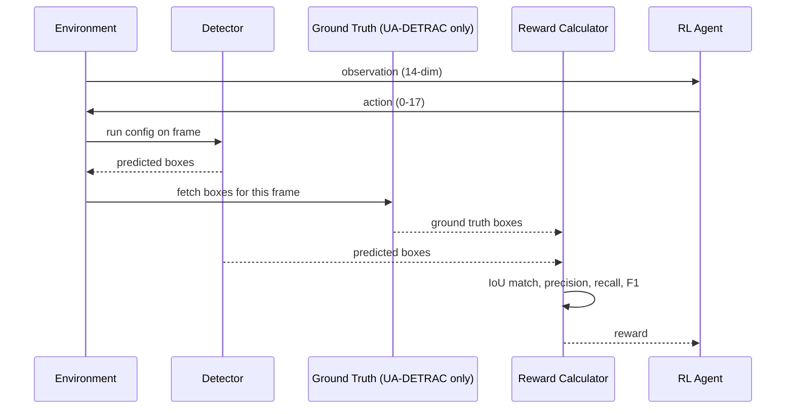

Every episode is a randomly sampled chunk of 150 to 300 frames from a randomly chosen video or sequence, reset with a fixed seed for reproducibility, and there is a deliberate one frame lag between choosing a configuration and it being applied, since a real streaming system cannot act on a frame before it has finished being decided about. Both DQN and PPO, via Stable-Baselines3, are trained on identical environments so their results are directly comparable rather than trained under subtly different conditions.

## Two datasets, two very different scenes

BDD-A is dashcam footage from a moving vehicle, mostly city driving, and its object density (measured as mean detections per frame using a fixed nano model as a reference so the measurement does not depend on which policy is being evaluated) sits mostly in the sparse to mid range. UA-DETRAC is a fixed traffic camera looking down at a multi lane road, and it is noticeably denser on average. The distribution below, computed over every held out video in both datasets, shows why this matters: a dataset with little density variation gives an adaptive policy little reason to ever change its behaviour, because there is no real trade off between model size and detection quality to discover.

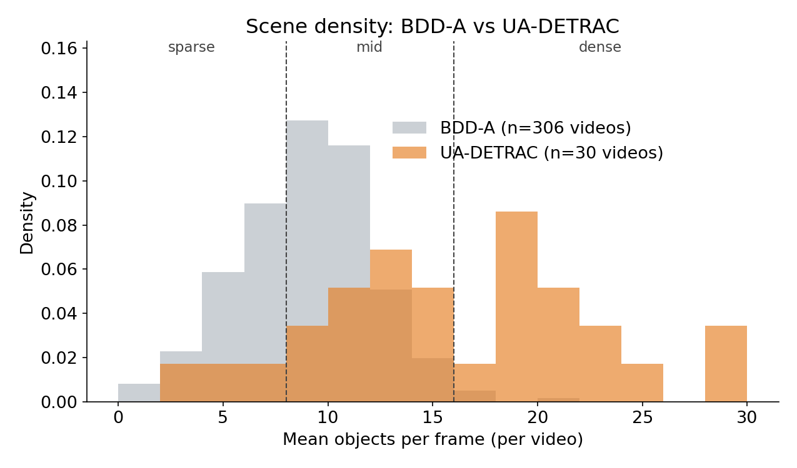

The two datasets also look different in a more literal sense. Below are real frames sampled from each, at low, medium and high object density, showing what the agent actually has to work with. The BDD-A frames are annotated with our own detector's output, since no ground truth boxes exist for this dataset. The UA-DETRAC frames are annotated with the real, human labeled ground truth.

<table>
<tr>
<td>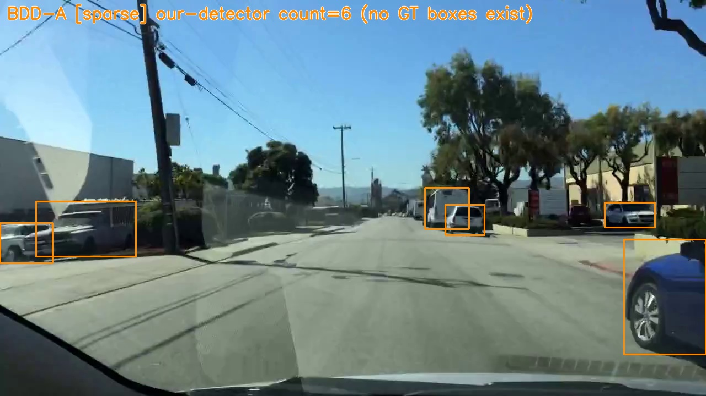</td>
<td>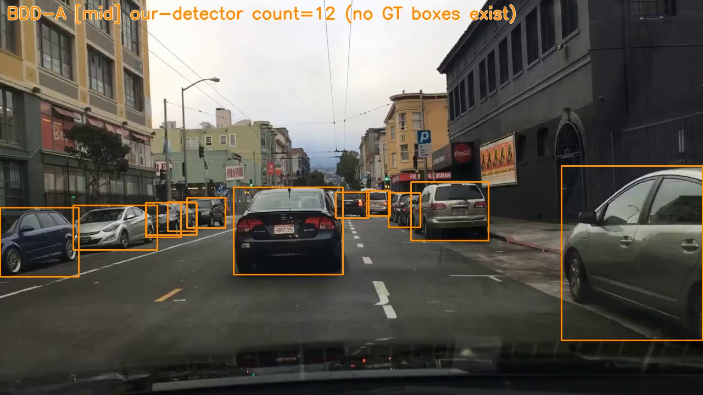</td>
<td>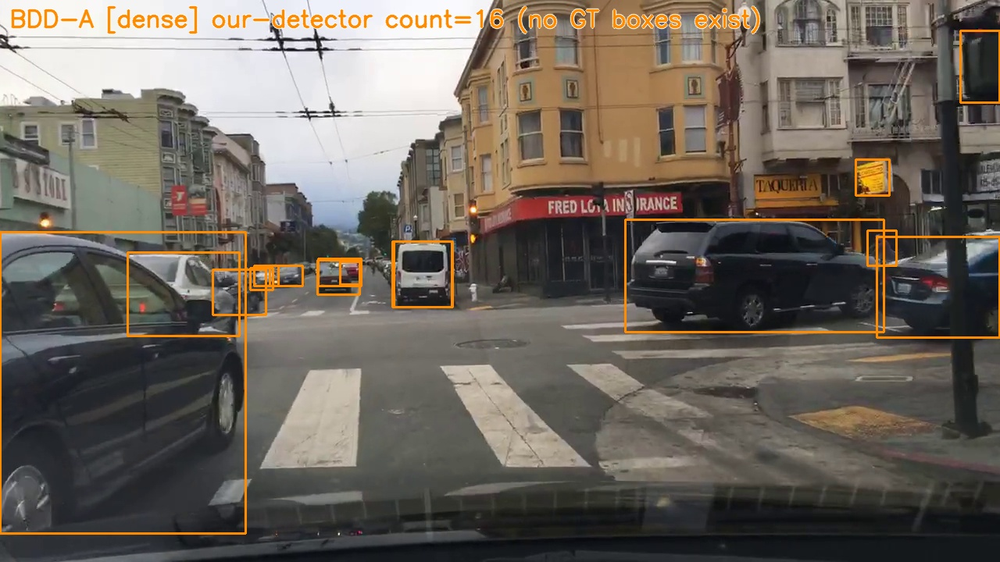</td>
</tr>
<tr>
<td>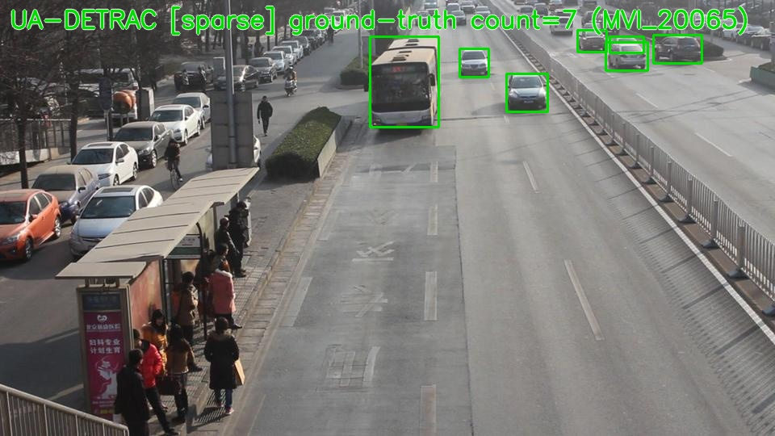</td>
<td>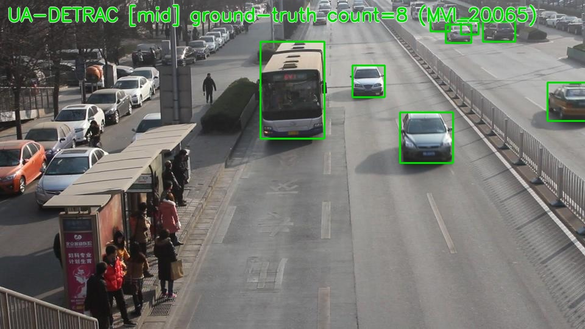</td>
<td>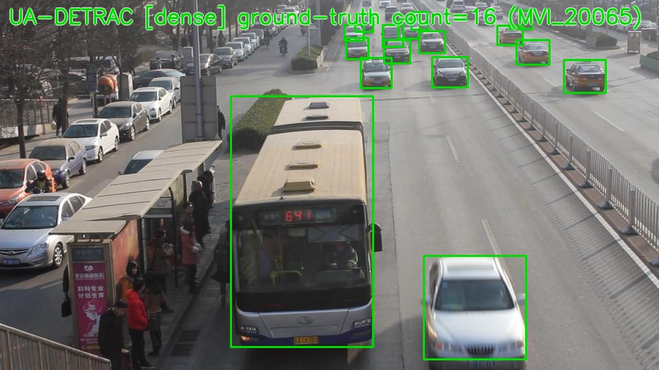</td>
</tr>
</table>

## Does it actually work: results on UA-DETRAC

This is the part that matters most, so it is worth being precise rather than promotional about it. DQN was trained for 120,000 steps and PPO for 300,000 steps, each from scratch with three seeds, on the sixty UA-DETRAC training sequences using the real IoU matched reward described above. Every policy was then evaluated on all forty held out test sequences, against every one of the eighteen fixed configurations rather than a hand picked few, plus a random policy, a simple object count threshold rule and a contextual bandit. The numbers below use the simulated hardware profile; the next section repeats the comparison with latency measured on the real board.

An earlier version of this evaluation, the one shown at the second review, built its test environments from the training split's configuration, so test sequences silently found no ground truth boxes and every detection scored as a false positive. That made the quality term meaningless at test time and rewarded whichever configuration was cheapest. The environment now resolves each sequence's own annotation file and refuses to run without one, and the table below is the corrected result.

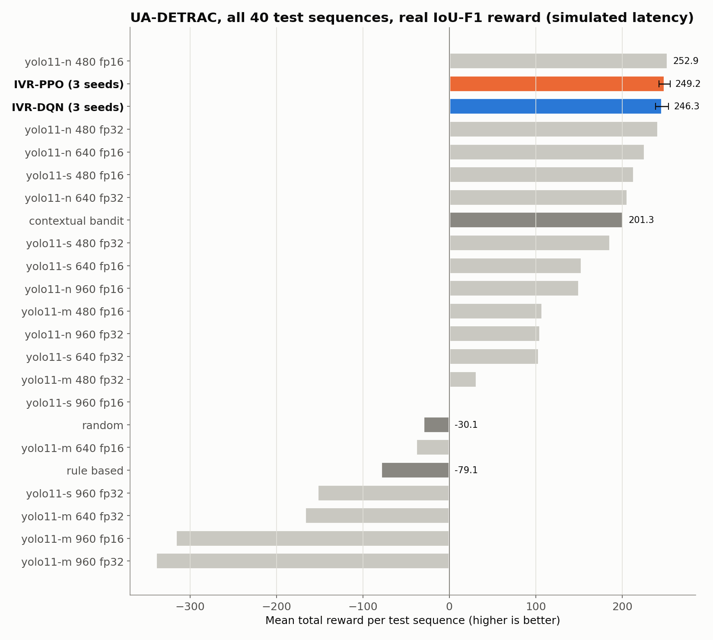

| Policy | Mean reward | Note |
|---|---|---|
| Always nano, 480, fp16 | 252.9 | best of the 18 fixed configurations |
| IVR PPO (3 seeds) | 249.2 ± 6.4 | two seeds converge exactly onto nano 480 fp16, one onto nano 480 fp32 |
| IVR DQN (3 seeds) | 246.3 ± 7.7 | one seed switches resolution with scene density, two settle near nano 480 fp16 |
| Always nano, 480, fp32 | 241.7 | |
| Always nano, 640, fp32 | 206.4 | |
| Contextual bandit | 201.3 | |
| Always small, 640, fp32 | 103.8 | |
| Random | -30.1 | |
| Rule based | -79.1 | |
| Always medium, 640, fp32 | -167.1 | |

Both trained policies clearly beat every non learning scheduler and every fixed configuration that was not chosen by searching all eighteen, with paired t tests far below p = 1e-8. What they do not do is beat the best fixed configuration. Picking the best fixed configuration separately for every single test video would only add 1.5 percent over always running nano at 480 pixels, so on this dataset there is almost nothing for an adaptive policy to gain, and the honest reading is that reinforcement learning reliably finds the best fixed configuration, or one within about five percent of it, on its own. The board measurements in the next section explain why: on UA-DETRAC's traffic camera footage, nano is not only the cheapest model but also among the most accurate, so a bigger model never buys detection quality here.

The adaptive behaviour is still real where it appears. The chart below is the seed 0 DQN policy's literal resolution choice over one held out video, plotted against the object count at that moment. While the scene is crowded, in the twenties, the policy holds at 640 pixels; when the count drops into the low teens it drops to 480 and stays there. Nobody hand coded that threshold, it emerged from training against reward, but it is one seed's behaviour rather than something every run learns.

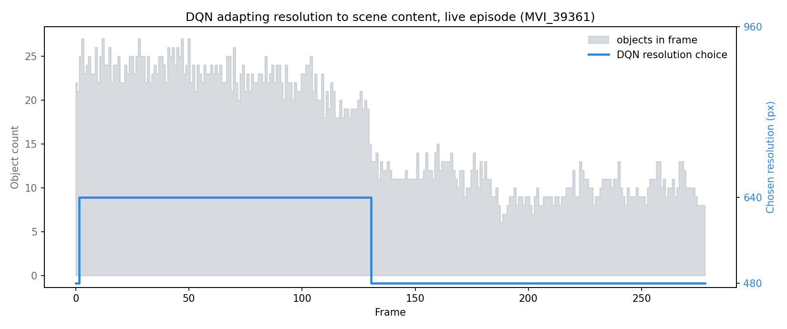

## Running on the real board

Everything above trains against a model of the edge device. The target is a Radxa ROCK 5C (RK3588S2, 8 GB), so every one of the eighteen configurations was converted and measured on it. The YOLO11 variants are exported to fixed shape ONNX on the host and converted on the board with RKNN-Toolkit2 into two precisions, fp16 and int8 calibrated on UA-DETRAC frames, because the NPU has no fp32 path. The runtime's fp32 and fp16 actions therefore run as NPU fp16 and NPU int8 respectively. Latency is measured end to end per frame, letterbox plus NPU plus box decoding and NMS, with the CPU, NPU and memory clocks pinned so the numbers repeat.

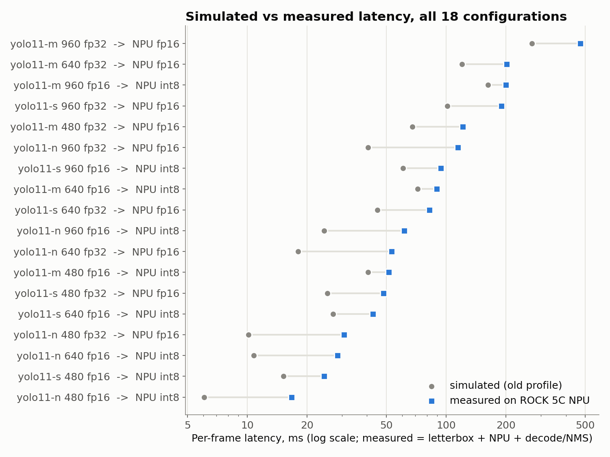

The simulated profile turned out to be optimistic by a factor of two to four. Nano at 480 pixels in int8 is the fastest configuration at 16.7 ms per frame, nano at 640 in fp16 takes 53 ms against a simulated 18, and medium at 960 in fp16 takes 472 ms. Using all three NPU cores barely helps a single stream at batch size one. Temperature stayed near 37 °C with the fan running, and the board has no power sensor, so power stays simulated; the unified memory delta per model was too noisy at these model sizes to replace the simulated memory estimate either.

The first int8 conversion lost between 0.12 and 0.36 detection F1, because quantizing the whole detection head puts pixel scale box coordinates, the distribution focal loss softmax and 0 to 1 class scores under shared int8 scales. Cutting the graph at the six raw per scale head outputs and decoding them on the CPU, the same approach Rockchip's model zoo takes, fixed it: on the same frames the board's F1 now sits within 0.03 of the GPU detector used during training for every configuration, so the quality the policy learns against is the quality it gets when deployed.

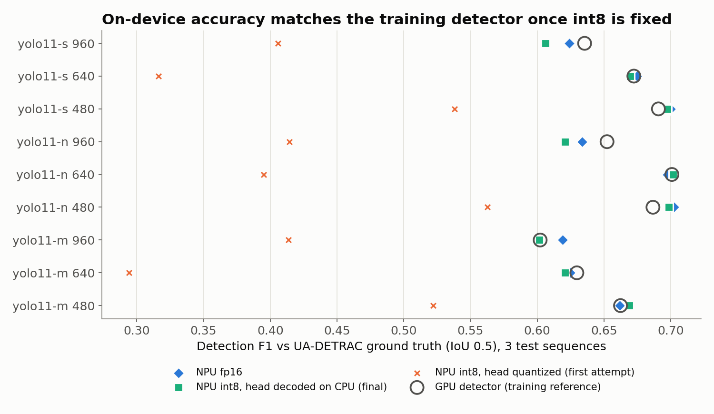

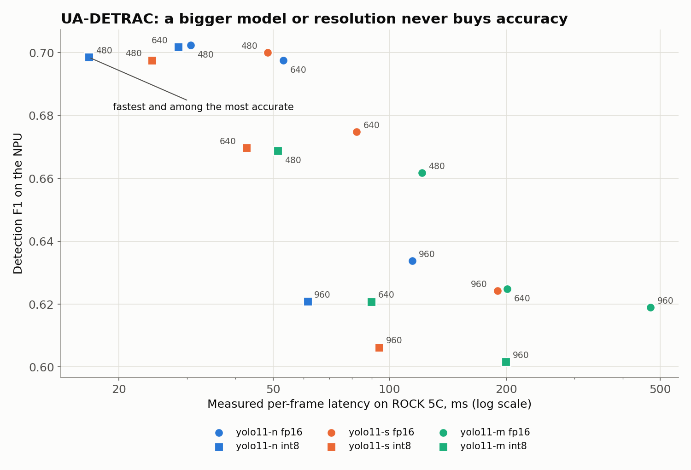

The measured numbers are written into `configs/hardware_measured.yaml`, which is `configs/hardware.yaml` with its `measured:` section filled in; the edge profile uses any measured value in place of its simulated estimate, and `--hardware configs/hardware_measured.yaml` trains and evaluates against the real board. Finally, `tooling_scripts/rknn_live_demo.py` closes the loop on the device itself: a trained policy reads the same fourteen dimensional observation from the repository's own scene analyzer and picks a configuration every frame, and the NPU runs it, switching models live. The whole loop, scene analysis, NPU inference and the policy decision, runs at 43 to 50 frames per second over a full 1180 frame held out video.

Both algorithms were then retrained from scratch against the measured profile, three seeds each, and evaluated on the same forty test sequences with the board's latency in the reward. The conclusion carries over from simulation and becomes sharper. All three PPO seeds converge exactly onto nano at 480 pixels in int8, which is also the best of the eighteen fixed configurations at 223.3, and DQN lands at 220.4 ± 3.8. Real latency punishes slow choices much harder than the simulated profile did, so the contextual bandit falls to 151.9 and random to -128.7, and every trained seed beats the bandit with paired t tests around p = 1e-19. Picking the best fixed configuration per video now adds only 0.8 percent.

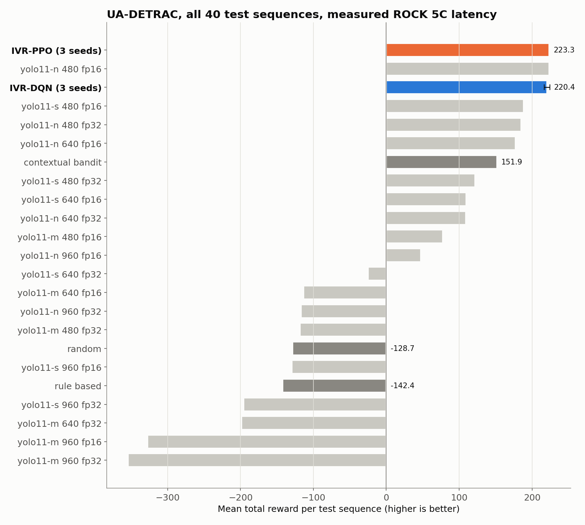

## When the budget changes: where adaptation wins

The two comparisons above share one assumption that real deployments rarely keep: the latency budget never changes. In practice the time a detector may spend per frame moves around, because the camera's frame rate is switched, another process takes the NPU, the board heats up, or a downstream controller needs answers faster for a while. A fixed configuration cannot follow that. Whatever it is, it is either fast enough for the tightest budget and wastes accuracy whenever there is time to spare, or accurate and late whenever the budget tightens.

The deadline experiment makes that concrete. Every frame now has a latency deadline drawn from 20, 30, 50, 100 and 250 ms, held for a random 50 to 150 frames (two to six seconds of video) and then redrawn. The levels sit between the latencies measured on the ROCK 5C, so each one unlocks a more accurate configuration: nano at 480 in int8 (16.7 ms), small at 480 (24.4 ms), small at 640 (42.8 ms), small at 960 (94.1 ms) and medium at 960 (199.6 ms), all int8. The agent sees the deadline that applies to the next frame as five flags, one per level, set when the deadline is at least that level. The reward keeps the quality term, now with the official UA-DETRAC scoring, drops the continuous latency and compute penalties, and instead charges 2.0 for every frame whose measured latency exceeds its deadline, which outweighs any accuracy a late frame could buy. Everything else, the forty test sequences, the measured board latency and the 0.3 switching penalty, is unchanged, and every policy evaluated on a video sees the same deadline schedule.

Two baselines that are not learned are included to keep the comparison honest. The lookup table is what an engineer would write by hand after profiling: for the current deadline, run the most accurate configuration whose measured latency fits, ranked by each configuration's F1 on the training split. The slowest fit variant needs no accuracy table and simply runs the slowest configuration that fits, on the theory that slower means more accurate.

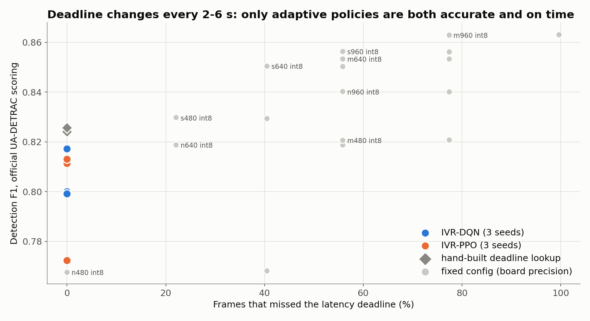

| Policy | Mean reward | Detection F1 | Frames late | Note |
|---|---|---|---|---|
| Deadline lookup table | 333.9 | 0.826 | 0% | hand built from the board profile and a training split accuracy table |
| Deadline lookup, slowest fit | 332.7 | 0.824 | 0% | hand built from the board profile only |
| IVR PPO, deadline masked, gamma 0.5 (3 seeds) | 329.0 ± 3.6 | 0.80 to 0.82 | 0% | seeds score 324.9, 331.1 and 331.1; given the latency profile |
| IVR DQN (3 seeds) | 326.8 ± 3.2 | 0.80 to 0.82 | 0% | seeds score 325.0, 325.0 and 330.5 |
| IVR PPO, gamma 0.5 (3 seeds) | 325.9 ± 7.3 | 0.77 to 0.81 | 0% | seeds score 329.8, 330.4 and 317.4 |
| Always nano, 480, int8 | 315.8 | 0.768 | 0% | best of the 18 fixed configurations |
| IVR PPO, gamma 0.95 (3 seeds) | 315.9 ± 0.2 | 0.768 | 0% | converges onto nano 480 int8 |
| IVR PPO, deadline masked, gamma 0.95 (3 seeds) | 320.5 ± 8.2 | 0.77 to 0.81 | 0% | seed 0 adapts (330.0), seeds 1 and 2 stay on nano |
| IVR PPO, curriculum, gamma 0.95 (3 seeds) | 249.7 ± 65.9 | 0.80 to 0.83 | 0 to 22% | seed 2 adapts (325.8), seeds 0 and 1 ignore the deadline |
| Contextual bandit | 240.5 | 0.796 | 12% | |
| Always small, 480, int8 | 213.5 | 0.830 | 22% | |
| Always small, 640, int8 | 116.7 | 0.851 | 40% | |
| Always medium, 960, int8 | -86.1 | 0.863 | 77% | most accurate configuration |

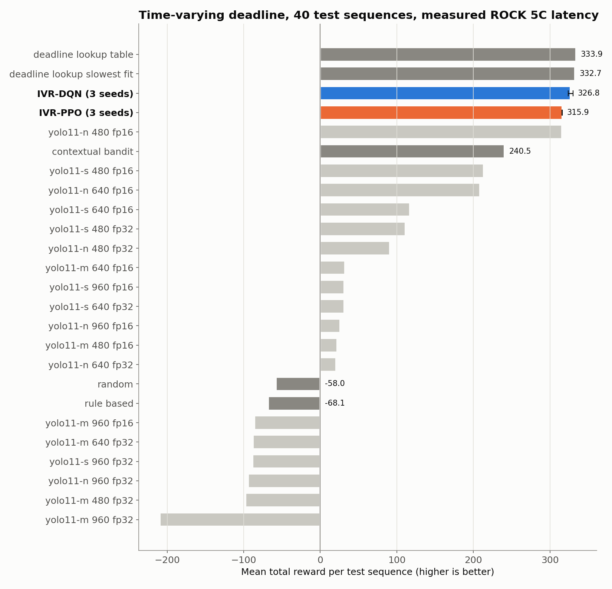

Every fixed configuration lands on one side of the trade off. The ones that are never late are the least accurate, and every configuration more accurate than nano at 480 misses between a fifth and nearly all of its deadlines. DQN was the first learned policy to get both: all three seeds meet every deadline on all forty test sequences while scoring 0.80 to 0.82 F1 against 0.768, and each seed beats the best fixed configuration by 9 to 15 reward per sequence, winning on 28 to 32 of the 40 sequences with Wilcoxon p values of at most 8e-5. The best seed runs nano on 29 percent of frames, small on 54 percent and medium on 17 percent, stepping up and down as the deadline moves. DQN still trails the hand built lookup table by 1 to 3 percent. The table is a strong baseline, since it is built from the exact profile the deadline levels were chosen from plus an offline accuracy measurement of every configuration, while DQN reaches nearly the same behaviour from reward alone, without being told which configuration is fast or accurate.

Getting there took two corrections, both worth recording. The first version gave the agent the deadline as a single log scaled number and both algorithms settled on nano everywhere. Probing the trained Q network showed why: its preference changed smoothly with the deadline instead of stepping at each level, so the penalty for running small at 20 ms leaked into the 30 ms level where small fits. Replacing the number with one flag per level, and shortening the discount factor from 0.99 to 0.95 so that the small per frame accuracy gaps are not drowned out by the long horizon value, produced the stepped behaviour above. PPO, with the same changes, still converges onto nano at 480 int8 on every seed: early in training its sampled larger configurations miss deadlines often, their probability falls quickly, and an on policy method that rarely samples them again never learns that they pay off when the budget is loose. DQN's replay buffer keeps learning from those early exploratory frames. A second PPO attempt with smaller, steadier updates (learning rate 1e-4 instead of 3e-4, rollouts of 4,096 steps, batches of 256, 300,000 steps) converged the same way and scored 315.8 on every seed, so the result does not hinge on one setting.

Two targeted fixes were then tried, three seeds each. The first masks every configuration whose measured latency exceeds the next deadline, with MaskablePPO from sb3-contrib, so a late frame becomes impossible and PPO only has to learn which fitting configuration is most accurate; this hands PPO the latency profile that DQN has to discover. The second keeps the information equal and changes the training instead: deadlines start at 100 ms and above, with 50, 30 and 20 ms joining at 40,000, 80,000 and 120,000 steps, and a late frame pays in proportion to how late it is rather than a flat 2.0 (evaluation keeps the flat penalty). Each fix produced one seed that adapts as well as DQN: the masked seed 0 scores 330.0 with 0 percent late frames, running nano, small and medium on 61, 18 and 20 percent of frames, and curriculum seed 2 scores 325.8, also never late, both beating the best fixed configuration on 32 of 40 sequences (p below 3e-6). The other seeds did not: two masked seeds still settle on nano even though they cannot be late, so the miss penalty is not the only cause and never switching is itself a comfortable optimum for PPO, and two curriculum seeds learn one configuration for every deadline and are late on every 20 ms frame. PPO could therefore learn the adaptive behaviour, but not reliably.

The two masked seeds that stayed on nano pointed at the real cause. A configuration choice mostly affects only its own frame, and the F1 of a single frame varies by about 0.2, while a larger model gains about 0.05 per frame. With a discount factor of 0.95 PPO judges each choice by roughly the next twenty frames of rewards, so the noise in that judgement is many times the gain it is trying to detect; DQN averages the same noise away over hundreds of thousands of replayed frames. Lowering PPO's discount factor to 0.5, so a choice is judged on about two frames, which still covers the one frame switching cost, fixed it. Plain PPO, with exactly the information DQN gets, now adapts in two seeds that score 329.8 and 330.4 and beat the best fixed configuration on 34 and 35 of 40 sequences (p below 6e-7), while the third moves only slightly (317.4). Deadline masked PPO adapts in all three seeds, 324.9, 331.1 and 331.1, never late, beating the best fixed configuration on up to 36 of 40 sequences (p = 1e-9); its two best seeds are the highest scoring learned policies in the project and are statistically indistinguishable from the hand built lookup table (333.9, p = 0.05), although masking hands them the latency profile. The deadline charts above show the plain gamma 0.5 PPO.

The same policy runs on the board. `rknn_live_demo.py` gives the deadline to the policy every frame, from the keyboard or from the same random schedule as training, and opens a live window with the detections, the configuration currently running on the NPU, its measured latency against the deadline and a scrolling timeline of both, so the switches are visible as they happen. With the clocks pinned, the best DQN seed met 99.9, 97.0, 99.9 and 99.6 percent of its deadlines over four full held out sequences (crowded and rainy, night, sparse, and cloudy, 1,120 to 1,655 frames each), measured end to end on the real NPU rather than taken from the profile, switching between nano, small and medium 11 to 19 times per sequence. Almost every late frame falls at the 20 ms deadline, 55 of 777 such frames against 1 of more than 4,600 at the looser levels: nano's 17.5 ms median leaves little margin under 20 ms and there is no faster configuration to switch to. Because it runs larger models whenever the deadline allows, the loop's median rate is 21 to 23 frames per second. The best plain PPO seed at gamma 0.5 behaves the same way on the board, meeting 99.9, 97.3, 99.9 and 99.2 percent of its deadlines, but it runs mostly small at 480 and switches only 3 or 4 times per sequence, so it loops at 34 to 36 frames per second.

## Repository layout

The codebase is organized as a small set of top level Python packages rather than one large wrapping package, so that the package names declared in `pyproject.toml` match the actual importable module paths and imports stay absolute rather than relying on deep relative paths across package boundaries.

```
configs/
  env/          environment configs: which dataset, which video source, episode length
  reward/       reward weight configs: proxy vs real backend, latency and compute weights
  training/     hyperparameter configs for DQN and PPO
  hardware.yaml          simulated edge device profile (Rockchip RK3588S2)
  hardware_measured.yaml the same profile with latency, NPU load and temperature measured on the ROCK 5C
  variants.yaml model pool definition (yolo11n/s/m, GFLOPs, weight file paths)
vision_pipeline/
  yolo_detector.py       thin wrapper around ultralytics YOLO, returns boxes + confidence + latency
  scene_analyzer.py      cheap pre-inference scene features
  video_frame_source.py  video file and multi-video dataset ingestion
  detrac_source.py       UA-DETRAC frame source and XML ground truth parser
reinforcement_learning/
  vision_runtime_env.py     the gymnasium.Env implementing the loop described above
  reward_calculator.py      ProxyReward and MapReward (the real IoU-F1 backend)
  observation_features.py   builds the 14-dim observation vector, plus the deadline flags when enabled
  train_runtime.py          unified DQN / PPO training entrypoint
runtime/
  environment_factory.py  wires yaml configs into a fully constructed environment
  edge_profile.py         the Rockchip hardware model, measured values override simulated ones
  latency_estimator.py    nominal per-config latency model
  system_telemetry.py     rolling latency / fps / gpu-snapshot bookkeeping
evaluation/
  baseline_schedulers.py  the fixed, random, rule based, bandit and deadline lookup baselines
  benchmark_runner.py     runs every policy over a dataset, computes paired statistics
model_management/
  model_variants.py         model pool registry
  runtime_config_space.py   flattens model x resolution x precision into the 18 discrete actions
tooling_scripts/
  detrac_full_eval_parallel.py  full UA-DETRAC test-split evaluation across policies
  rknn_export_onnx.py           ONNX export plus calibration and evaluation frames for the board
  rknn_convert.py               fp16 and int8 RKNN conversion (runs on the board)
  rknn_benchmark.py             on-device latency, NPU load and detection dumps (runs on the board)
  rknn_measured_profile.py      scores board detections and writes hardware_measured.yaml
  rknn_live_demo.py             closed-loop policy + NPU demo with a live window and keyboard deadline (runs on the board)
  make_review_charts.py         renders the charts in this README
  ...                           detached runner, experiment sequencers, offline validation suite
docs/               design notes and the screenshots referenced in this README
train.py, eval.py, sweep.py    root level command line entrypoints
```

## Running it

Training and evaluation both go through the root level launcher scripts, which take yaml config paths rather than long argument lists, so a full run looks like:

```
python train.py --env configs/env/env_detrac.yaml --reward configs/reward/reward_detrac.yaml --training configs/training/training_bdd.yaml --algorithm dqn --seed 0

python tooling_scripts/detrac_full_eval_parallel.py --fixed all --baselines --model ivr_dqn_s0=training/dqn_detrac_final.zip --output test_detrac_eval.csv
```

Adding `--hardware configs/hardware_measured.yaml` to either trains or evaluates against latency measured on the real board instead of the simulated profile, and `--constraints on` turns on the stress-test resource constraints. Swapping `--env`/`--reward` to the BDD-A configs trains and evaluates the same way against the older proxy reward dataset. `tooling_scripts/validate_pipeline.py` runs the offline validation suite (constraint behaviour, switch penalty, checkpoint round tripping, observation wiring, and that profile latency actually reaches the reward) and is meant to be run after any change to the environment, reward or hardware model before trusting a long training run to it.

The board side runs from a copy of `tooling_scripts/` on the ROCK 5C: `rknn_export_onnx.py` on the host stages the ONNX models and frames, then `rknn_convert.py`, `rknn_benchmark.py --mode latency` and `--mode detect` run on the board, and `rknn_measured_profile.py` back on the host turns the results into `configs/hardware_measured.yaml`.

The time varying deadline experiment swaps in its own environment, reward and training configs, and the evaluation adds the two lookup schedulers:

```
python train.py --env configs/env/env_detrac_deadline.yaml --reward configs/reward/reward_detrac_deadline.yaml --training configs/training/training_dqn_deadline.yaml --hardware configs/hardware_measured.yaml --algorithm dqn --seed 0 --log-name dqn_detrac_deadline_s0

python tooling_scripts/detrac_full_eval_parallel.py --env configs/env/env_detrac_deadline.yaml --reward configs/reward/reward_detrac_deadline.yaml --hardware configs/hardware_measured.yaml --fixed all --baselines --deadline-lookup output/deadline_lookup_accuracy.yaml --model ivr_dqn_deadline_s0=training/dqn_detrac_deadline_s0_final.zip --output test_detrac_deadline_eval.csv
```

The lookup table's accuracy file holds the official scoring F1 of each model and resolution on the training split. On the board, the live demo opens a full screen window on the desktop, so it can be shown over VNC, and the deadline is changed from the keyboard while it runs (1 to 5 pick 20, 30, 50, 100 or 250 ms, A replays a random schedule, N moves to the next video, P pauses, Q quits). Pin the clocks first, as for the benchmarks, since a reboot resets them:

```
python rknn_live_demo.py --repo ~/ivr/repo --bundle ~/ivr/bundle --policy ~/ivr/policies/dqn_detrac_deadline_s2_final.zip --sequence MVI_40864 MVI_40742 --show --fullscreen --loop
```

## Honest state of things right now

The pipeline is now validated end to end, from training on the host to a policy switching models live on the real NPU, and the detection quality a policy is trained against matches what the board actually delivers. Under a fixed latency budget the trained policies match the best fixed configuration but do not beat it, because on fixed traffic cameras the scene alone rarely changes which configuration is best. Under a latency budget that changes over time, the situation the runtime was designed for, DQN beats every one of the eighteen fixed configurations and every non learning scheduler while meeting every deadline, and comes within 1 to 3 percent of a lookup table hand built from the board profile. PPO does the same once its discount factor is short enough for the small per frame accuracy gaps to show, in two of three seeds without help and in all three with deadline masking. Footage where scene difficulty itself changes which model is best, small or distant objects, night scenes or aerial views, would test the scene side of the observation the way the deadline experiment tests the hardware side. Power remains simulated until the board can be measured with an external USB-C meter.
